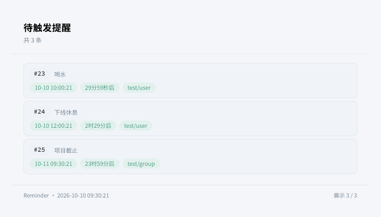

<div align="center">


# ErisPulse Reminder

**提醒模块 —— 聊天中设置定时提醒，重启自动恢复。**

基于 ErisPulse 2.10 归属化调度（spawn_later）与内置 ORM 的轻量提醒模块，支持声明式时长参数与多轮恢复。

<p>
  <a href="https://pypi.org/project/ErisPulse-Reminder/"></a>
  <a href="https://pypi.org/project/ErisPulse-Reminder/"></a>
  <a href="./LICENSE"></a>
  <a href="https://github.com/ErisPulse/ErisPulse-Reminder"></a>
  <a href="https://pepy.tech/project/ErisPulse-Reminder"></a>
  <a href="https://github.com/ErisPulse/ErisPulse"></a>
</p>

<p>
  <a href="./README.md">简体中文</a> | <a href="./README.en.md">English</a>
</p>

</div>

---

## 简介

Reminder 是基于 [ErisPulse](https://github.com/ErisPulse/ErisPulse/) 架构开发的轻量提醒模块：

- `/提醒 30m 喝水`：声明式时长参数（`90s` / `1h30m` / `1d` 等自动折算秒）
- 到期经适配器发送到原会话（私聊/群聊均可）
- 提醒记录内置 ORM 持久化，**重启自动恢复**：未到期重新调度，已过期立即补发
- 调度任务归属化（`spawn_later` owner），模块卸载时自动取消
- 每用户挂起上限、单条时长上限、内容长度约束
- 列表经 Takumi 渲染为卡片，不可用时降级文本

要求 ErisPulse >= 2.10.0。

---

## 效果展示

| `/提醒 列表` |
|:---:|
|  |

---


---

## 安装

```bash
epsdk install ErisPulse-Reminder
```

---

## 命令

| 命令 | 说明 |
|------|------|
| `/提醒 <时长> <内容>` | 设置提醒，如 `/提醒 30m 喝水`、`/提醒 1h30m 下线休息` |
| `/提醒 列表` | 查看本人的待触发提醒 |
| `/提醒 取消 <编号>` | 取消一条提醒 |

时长语法：`90s`（秒）、`30m`（分）、`2h`（时）、`1d`（天），可组合如 `1h30m`。

---

## 配置说明

```toml
[Reminder]
max_reminders_per_user = 20     # 单用户同时挂起的提醒上限
max_duration = "30d"            # 单条提醒最大时长
reminder_prefix = "提醒："       # 到期消息前缀
list_max = 10                   # 列表单次展示条数
render_card = true              # 列表用 Takumi 渲染为卡片
theme = "auto"                  # 卡片配色 (auto/light/dark)
```

| 配置项 | 类型 | 默认值 | 说明 |
|--------|------|--------|------|
| `max_reminders_per_user` | int | `20` | 每用户挂起上限 |
| `max_duration` | str | `30d` | 单条最大时长 |
| `reminder_prefix` | str | `提醒：` | 到期消息前缀 |
| `list_max` | int | `10` | 列表条数 |
| `render_card` | bool | `true` | 卡片渲染 |
| `theme` | str | `auto` | 卡片配色 |

---

## 注意事项

1. 到期发送失败时提醒仍标记完成（避免无限重试），失败记录在日志
2. 提醒发送到设置时的原会话（群聊则发回群）
3. 记录存储于框架存储后端，随数据一起备份迁移

---

## 参考链接

- [ErisPulse 主库](https://github.com/ErisPulse/ErisPulse/)
- [运行时调度文档](https://github.com/ErisPulse/ErisPulse/tree/main/docs/zh-CN/advanced/connections.md)
- [ORM 文档](https://github.com/ErisPulse/ErisPulse/tree/main/docs/zh-CN/developer-guide/orm.md)
